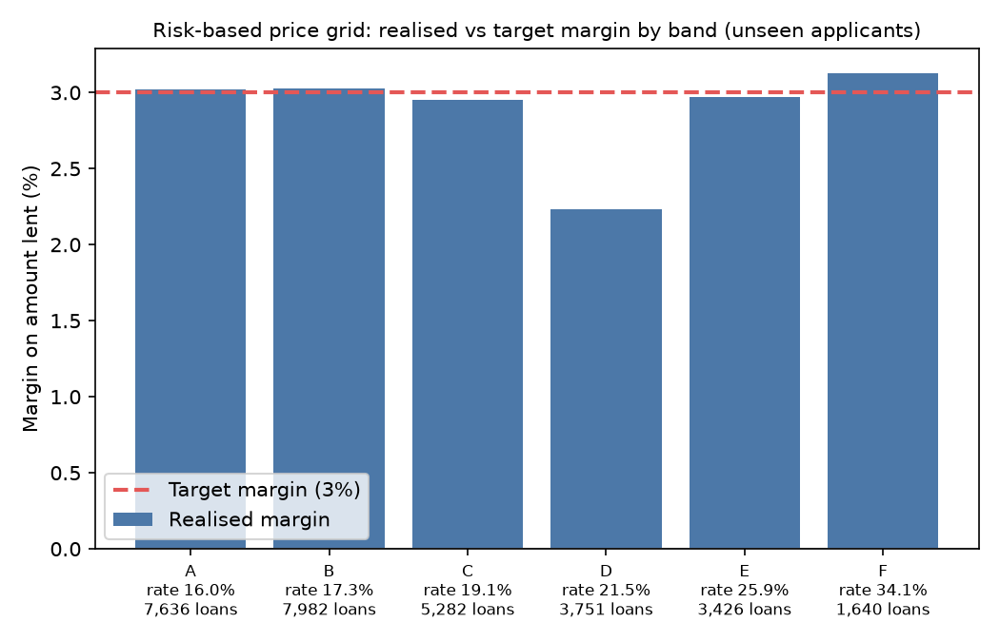
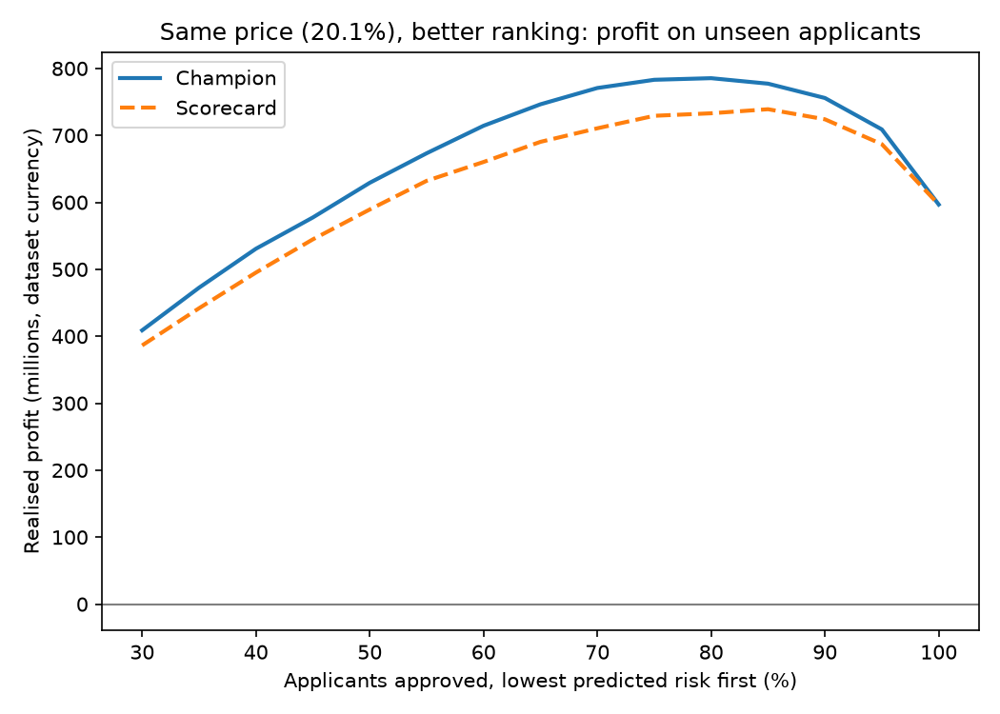
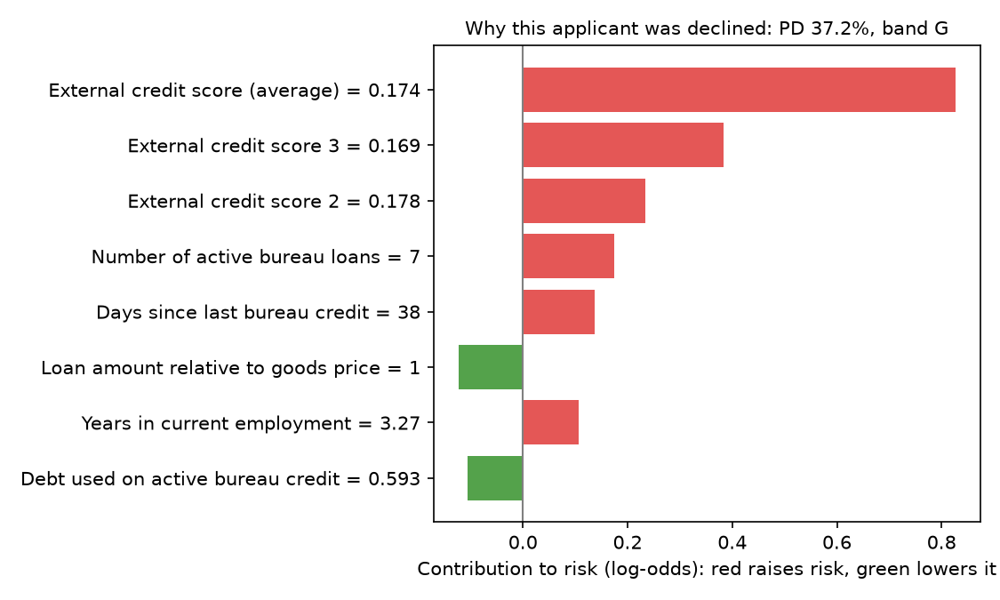
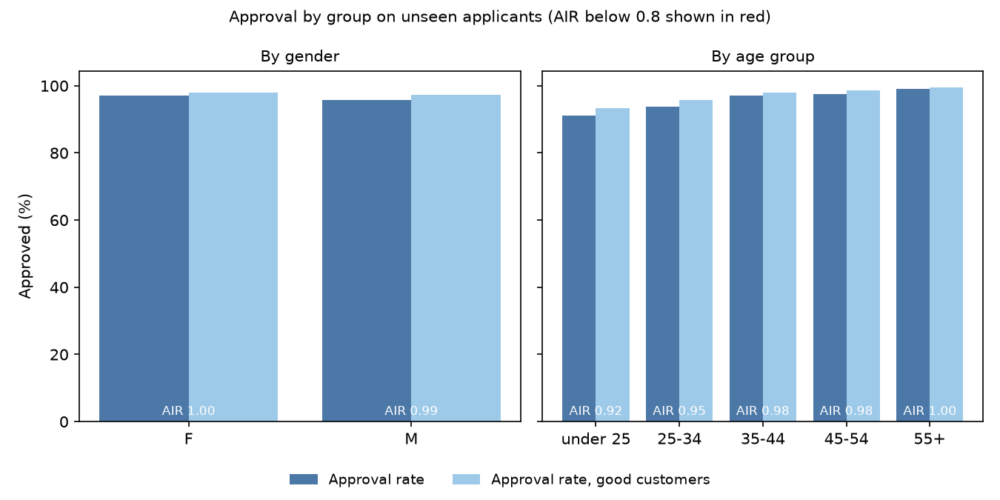
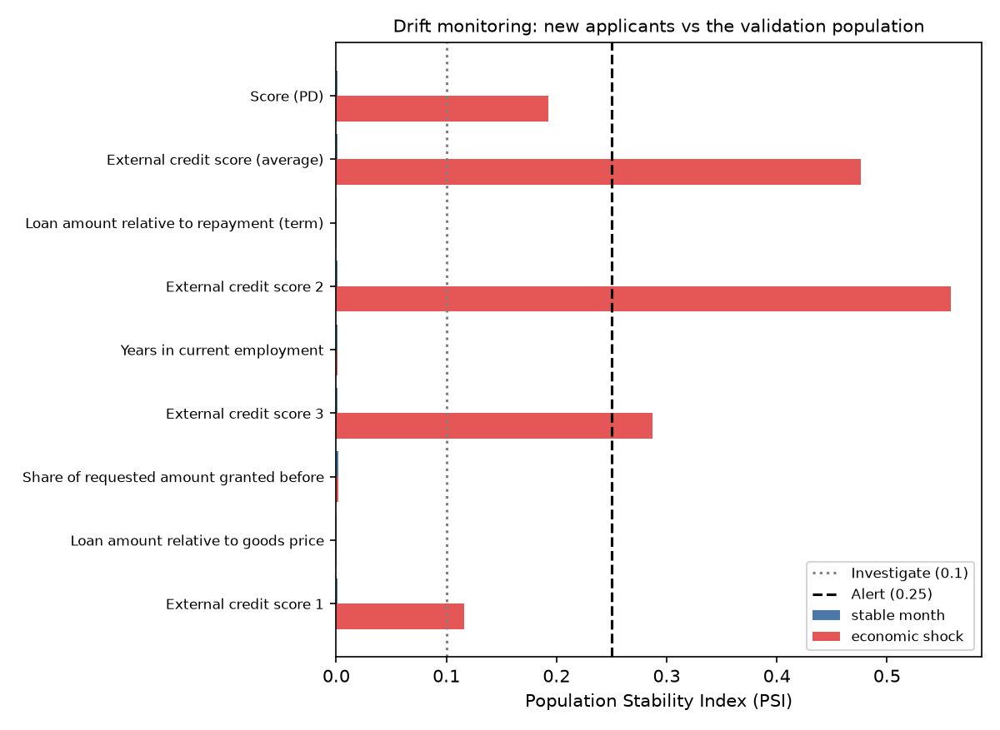

# Credit Risk Scoring & Risk-Based Loan Pricing

> **Status: complete.** SQL feature pipeline, tuned LightGBM + XGBoost ensemble (+0.036 AUC vs scorecard), calibrated risk-based pricing, TreeSHAP reason codes, fairness audit, model card, FastAPI service with drift monitoring, Docker and CI.


## Business problem

A consumer lender wants to approve more good borrowers, price each loan to its risk, and keep
expected losses within target, including **thin-file** applicants with little or no credit history.
This project builds the full decision engine: probability of default (PD) → risk band →
approve / decline → interest rate, with a reason for every decision.

## Data

[Home Credit Default Risk](https://www.kaggle.com/competitions/home-credit-default-risk): about 307,000
real loan applications with credit-bureau history, previous applications and repayment records
(7 linked tables). The data is not stored in this repo; the pipeline downloads it.

## Approach (stage 1)

```
Kaggle CSVs ──► DuckDB staging tables ──► SQL feature models ──► validation ──► baseline logit
                                           (sql/features/*.sql)    (fails loudly)  (Statsmodels)
```

- **SQL feature engineering** in DuckDB: affordability ratios, bureau debt and arrears in the last
  12 months, refusal history, repayment behaviour. Window functions find each applicant's most
  recent loan and decision.
- **Data traps handled:** split instalment payments are collapsed before measuring underpayment;
  the `365243` employment placeholder becomes missing plus a flag; "no history" (counts = 0) is kept
  separate from "unknown" (ratios = NULL).
- **Fairness by design:** gender and age are kept in a separate `protected_attributes` table and can
  never enter the model. They are used only for fairness checks (credit scoring is high-risk under
  the EU AI Act).
- **Validation gate:** one row per applicant, valid targets, no protected attributes, no infinite
  values, no near-empty columns. The pipeline stops if any check fails.
- **Interpretable baseline:** logistic regression with standardised inputs, odds ratios per standard
  deviation, and an automatic check that every coefficient points in the business-expected direction.

## Results

Stage 1 results (baseline on validation split) are written to `reports/baseline_metrics.json`.
_To be summarised here after the full run._

| Model | ROC-AUC | Gini | KS | PR-AUC |
| --- | --- | --- | --- | --- |
| **Champion: LightGBM + XGBoost average** | **0.776** | **0.551** | **0.419** | **0.262** |
| Baseline scorecard (13 features) | 0.740 | 0.479 | 0.360 | 0.221 |

Champion vs scorecard on 61,503 held-out applicants: **+0.036 AUC** (95% CI +0.032 to +0.040).

## Pricing results (stage 3)

Risk-based price grid, checked on 30,752 applicants it never saw: every approved band lands close to its 3% target margin.



At the same price and 80% approval, the champion approves a portfolio with a 4.58% default rate vs 5.26% for the scorecard: 54 fewer defaults and about 17 million more profit per 10,000 applications.



## Explainability and fairness (stage 4)

Every score comes with its top three reasons, computed with TreeSHAP. Example: why one applicant was declined.



Fairness audit on 30,752 unseen applicants: every gender and age group passes the four-fifths rule on approval rates. Small calibration gaps (1–1.7 points) and lower ranking accuracy for the youngest and oldest groups are documented and monitored, not corrected with protected attributes. Full details in the **[model card](docs/model_card.md)**.



## Scoring API and monitoring (stage 5)

A FastAPI service turns the models into a lending decision engine: send an applicant's features, get back their **probability of default, risk band, approve/decline, interest rate and top three reasons**.

```bash
python -m src.build_serving          # package models, calibrator, price grid
uvicorn src.api:app --port 8000      # then open http://127.0.0.1:8000/docs
```

Example response for a declined applicant:

```json
{
  "pd": 0.50,
  "risk_band": "G",
  "decision": "decline",
  "interest_rate": null,
  "reasons": [
    "External credit score (average) is lower than typical (0.05 vs 0.52)",
    "External credit score 2 is lower than typical (0.05 vs 0.57)",
    "Share of instalments paid late is higher than typical (0.60 vs 0.00)"
  ]
}
```

**Drift monitoring.** `python -m src.monitor --simulate` compares new applicants with the validation population using the Population Stability Index. A normal month stays stable (PSI about 0.001); a simulated downturn triggers alerts on the external credit scores (PSI up to 0.56) before the score itself crosses the alert line.



**Docker.** `docker build -t credit-risk-api .` then `docker run -p 8000:8000 credit-risk-api`. The image pins the exact library versions that trained the models; CI builds it and calls the running container on every push.

## Roadmap

1. ✅ SQL features, validation, interpretable baseline
2. ✅ Gradient boosting + stacking, Optuna tuning, MLflow tracking, calibration
3. ✅ Calibration, risk-based pricing grid and profit-vs-approval curve
4. Champion vs challenger Bayesian A/B test
5. ✅ SHAP reasons, fairness report, model card
6. ✅ FastAPI scoring service, Docker, monitoring (PSI)

## How to run

```bash
python -m venv .venv
.venv\Scripts\activate          # Windows  (macOS/Linux: source .venv/bin/activate)
pip install -r requirements.txt
pytest                           # 93 tests

# Full pipeline on the real data (needs a Kaggle API key)
python -m src.pipeline           # 1. SQL features, validation, baseline scorecard
python -m src.train_models       # 2. tuned LightGBM + XGBoost ensemble (about 40 min)
python -m src.price_loans        # 3. calibration and risk-based pricing
python -m src.explain_and_audit  # 4. reason codes, fairness audit, model card
python -m src.build_serving      # 5. package for the API
python -m src.monitor --simulate #    drift monitoring demo
uvicorn src.api:app --port 8000  #    scoring API

# Every step also runs on synthetic data in seconds: add --sample
```

## Project structure

```
config/config.yaml        all paths and parameters
sql/features/             feature logic, one SELECT per file, run in order
src/                      pipeline code (download, load, features, validate, baseline)
tests/                    unit tests with hand-checked expected values
reports/                  generated metrics and coefficients
```
